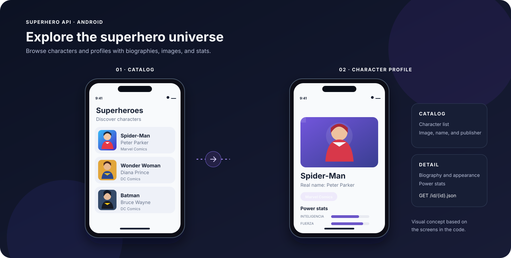
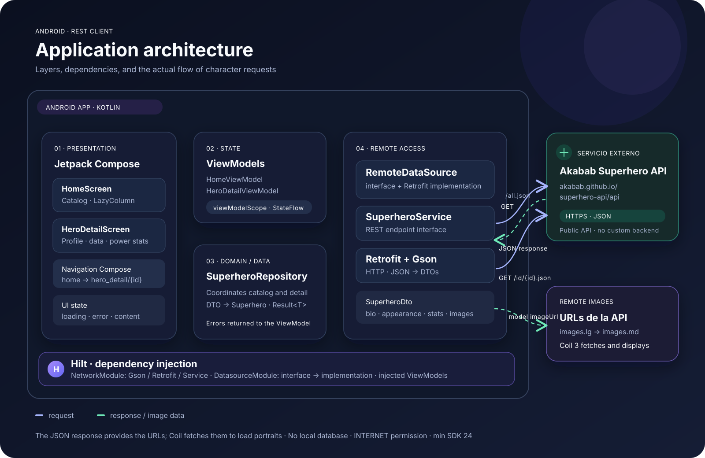
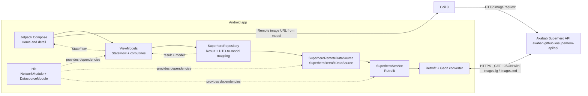

# Superhero API

An Android app for exploring a superhero catalog and viewing detailed character profiles. It consumes a public REST API, transforms its JSON responses, and displays the data with Jetpack Compose.



> **Illustrative mockup:** this visual represents the screens and data handled by the project; it is not a screenshot of the running app.

## Architecture map

This project is an Android client. It does not include its own server or a local database: character requests go from the app to the public Akabab API over HTTPS.





## REST API calls

`SuperheroService` declares two suspendable operations:

| App action | Method and path | Purpose |
|---|---|---|
| Open the catalog | `GET /all.json` | Downloads the full list for the home screen. |
| Open a character | `GET /id/{id}.json` | Fetches one character by its ID. |

The configured base URL is `https://akabab.github.io/superhero-api/api/`. Retrofit builds the requests, and `GsonConverterFactory` converts the JSON responses into Kotlin DTOs. The repository maps those DTOs to the `Superhero` model, normalizes some optional fields, and returns the result as `Result`.

**Request flow:** Compose screen → ViewModel → repository → remote data source → Retrofit service → REST API. Responses return through the same layers; the ViewModel updates a `StateFlow`, and Compose redraws the screen with the data, a loading indicator, or an error message. Selecting a character in the catalog passes its ID to the detail route.

Character images are loaded by Coil 3 using the URLs provided by the API. The app requires the `INTERNET` permission for API requests and images.

## Project components

### Presentation

- **Jetpack Compose and Material 3:** declarative UI and a theme that supports dynamic colors on Android 12 and later.
- **Navigation Compose:** `home` and `hero_detail/{heroId}` routes; the detail screen receives the ID and provides a way back to the catalog.
- **MVVM:** `HomeViewModel` and `HeroDetailViewModel` load data in `viewModelScope` and expose state through `StateFlow`.
- **Screen states:** loading, errors with a retry action on the catalog, and content when a response arrives successfully.

### Data and networking

- **Retrofit 2.11:** declarative HTTP client for the REST endpoints.
- **Gson:** deserializes JSON responses into `SuperheroDto` and nested DTOs.
- **Repository:** coordinates catalog and detail requests, handles errors, and maps DTOs to domain models.
- **Coil 3:** downloads and displays remote character portraits.
- **No local persistence:** data is requested from the API; the project does not implement a database or domain-level cache.

### Dependency injection

- **Hilt** initializes the dependency container in `SuperheroApplication`.
- `NetworkModule` provides singleton instances of Gson, Retrofit, and `SuperheroService`.
- `DatasourceModule` binds `SuperheroRemoteDataSource` to `SuperheroRetrofitDataSource`.
- ViewModels receive `SuperheroRepository` through injection.

## Data model

API responses are received as `SuperheroDto` and converted to `Superhero`. The model includes the character's ID and name, real name, publisher, alignment, occupation, first appearance, gender, race, height, weight, image URL, and power stats (intelligence, strength, speed, combat, durability, and power).

The home screen lists characters with an image, name, real name, and publisher. The detail screen shows the character's image and attributes, along with power stats.

## Technologies

- Kotlin and Android Gradle Plugin
- Jetpack Compose, Material 3, and Navigation Compose
- AndroidX Lifecycle and ViewModel
- Retrofit and Gson
- Hilt and KSP
- Coil 3
- JUnit and AndroidX Test (dependencies configured)

## Project structure

```text
app/src/main/java/com/example/superhero_api/
├── data/
│   ├── datasource/       # Remote data source contract and Retrofit implementation
│   ├── dto/              # API DTOs and model mapping
│   ├── injection/        # Network providers and Hilt bindings
│   ├── model/            # Domain models
│   └── repository/       # Data access and result handling
├── navigation/           # Routes and NavHost
├── ui/
│   ├── screens/home/     # Catalog, state, ViewModel, and card
│   ├── screens/heroedetail/ # Detail screen, state, and ViewModel
│   └── theme/            # Compose colors, typography, and theme
├── MainActivity.kt
└── SuperheroApplication.kt
```

## Requirements and setup

1. Open the project in Android Studio with Kotlin and Gradle support.
2. Use an Android SDK that includes **compileSdk 37**, as configured in the `app` module.
3. Sync Gradle and run the `app` configuration on an emulator or Android device.

The app uses `minSdk 24`, `targetSdk 37`, and version `1.0` (`versionCode 1`). An internet connection is required to fetch the catalog and load images.

## Short repository description

> An Android app built with Kotlin and Jetpack Compose for exploring superheroes and viewing their profiles. It consumes a REST API with Retrofit and Gson, structures its layers with MVVM and Hilt dependency injection, and loads character portraits with Coil.
